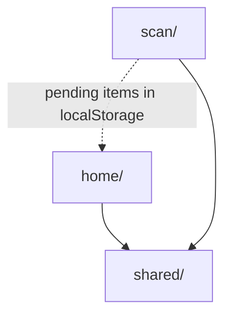

# Project structure

Plain static site (HTML + JavaScript, no build step). Two pages: the home page `index.html` and the scan page `scan/scan.html`.

## Directory layout

```
index.html            Home page markup; loads the scripts below
shared/               Used by every page; must not depend on a page
  items.js              Item rules: zones, defaults, expiry dates          -> window.Items
  storage.js            The only code that reads/writes items (async)      -> window.ItemStore
home/                 Scripts of the home page
  common.js             inventoryData, reloadItems, tryStore, escapeHtml, expiryStatus
  drawer.js             Slide-out storage-zone menu
  expiry-alert.js       "Expiring Soon" section and its scroll-in animation
  inventory.js          Zone views (All, Cold Store, Freezer, Outside) and item cards
  expiry-picker.js      Year / month / day selectors
  item-modals.js        "Add to Fridge" and "Edit / Move" dialogs
  main.js               Startup (loaded last)
scan/                 The scan page
  scan.html             Page markup and UI code
  scan-core.js          Pure helpers: name parsing, validation, image compression  -> window.ScanCore
  scan-api.js           Calls to the recognition providers                         -> window.ScanApi
  tests.html            In-browser unit tests of scan-core / scan-api
test/                 Automated browser tests (pytest + Playwright)
doc/                  Documentation
UI/                   Design notes
```

## Dependency rules



- `shared/` depends on nothing outside itself (`storage.js` uses `items.js`, not the reverse).
- `home/` and `scan/` may use `shared/`, but never call each other; they only exchange data through storage.
- Only `shared/storage.js` reads or writes the item data.
- Rules used by more than one place (zones, expiry format, item defaults) live in `shared/items.js`.

## Script load order

Scripts are plain `<script src>` files that share one global scope per page, so the order of the tags matters.

Home page: `shared/items.js`, `shared/storage.js`, `home/common.js`, `home/drawer.js`, `home/expiry-alert.js`, `home/inventory.js`, `home/expiry-picker.js`, `home/item-modals.js`, `home/main.js`.

Scan page: `shared/items.js`, `scan-core.js`, `scan-api.js`.
